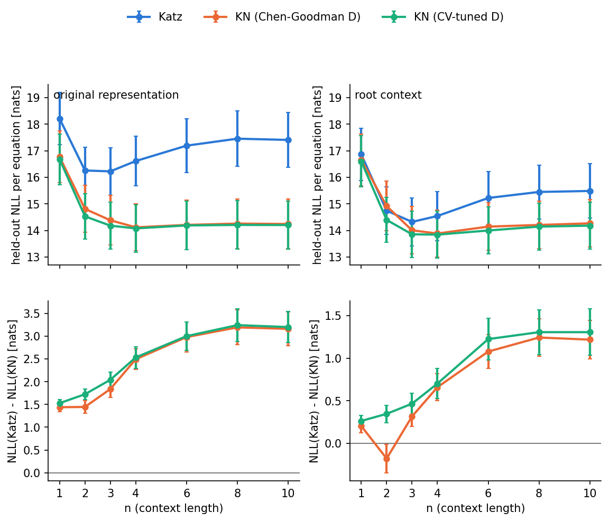
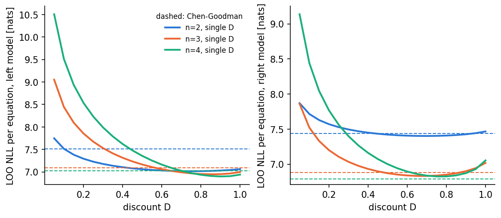
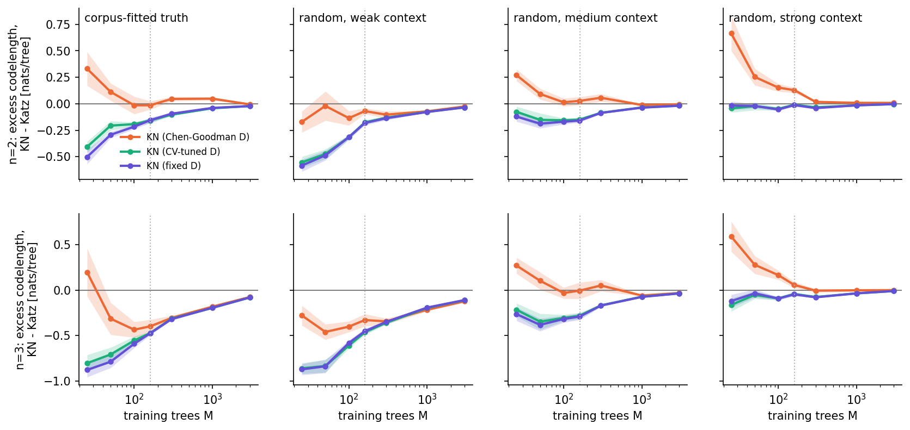
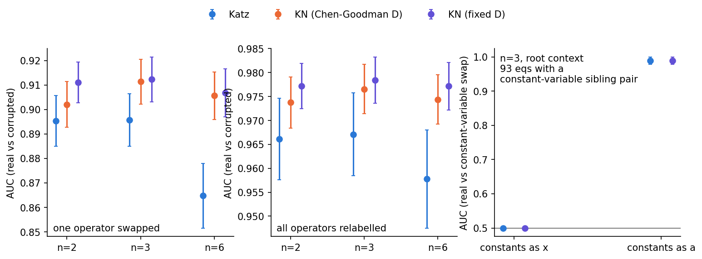
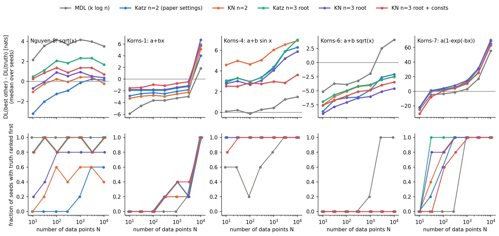
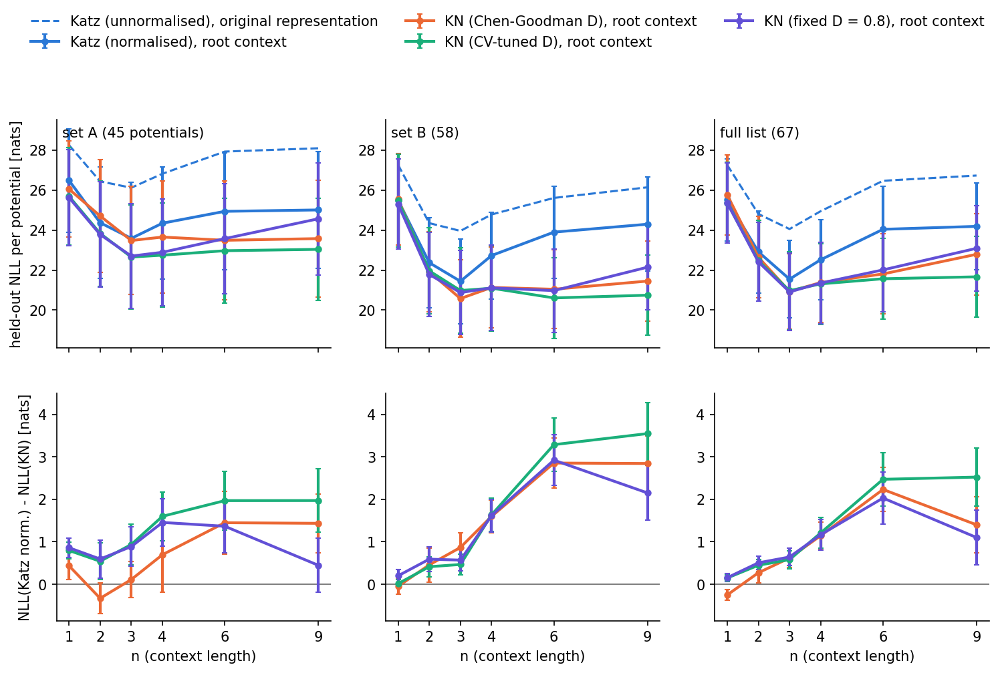
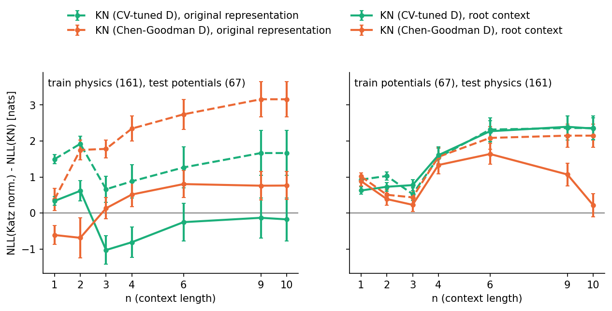
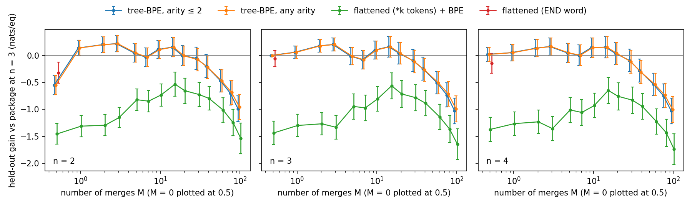

# Kneser–Ney vs Katz back-off function priors: implementation and assessment

Date: 2026-11-10. All numbers below are produced by the scripts in `assessment/` (see
"Reproducing"). NLL = negative log-probability in nats, i.e. the structural codelength that the
prior contributes to the MDL/Bayesian model selection. Lower is better.

The Katz model in this report is that of version 0.2.1 of the package. Priors computed before
version 0.2.0, including those of Bartlett, Desmond & Ferreira (2023) and Sousa et al. (2024), used
version 0.1.0, whose right-child model omits the parent from the context at n = 2 (in general the
most distant symbol of the context). On the physics corpus at n = 2 the two versions differ in 94%
of the priors of ESR's core_maths functions up to complexity 5, by a median of 0.54 nats and at most
4.7 nats. For the 20 inflationary potentials that Sousa et al. (2024) ranked with this prior at
n = 9 they differ by −1.1 to +2.5 nats. Version 0.1.0 reproduces the published values for these
potentials to within 0.2 nats. The configurations of published work studied below (context
length, root context and normalisation) are evaluated with version 0.2.1 and do not reproduce the
published priors.

## Summary

1. **With tuned or fixed discounts, Kneser–Ney (KN) is a better function prior than Katz back-off
   on all within-corpus held-out and synthetic tests, by a margin that depends strongly on the
   context length n.** Across sources (trained on the Feynman equations, tested on the others) the two
   are not significantly different at n ≤ 3 (item 5), and the Chen–Goodman discount estimates make KN
   worse than Katz on small synthetic corpora (item 4). With equation families held out and discounts tuned
   by nested cross-validation, KN lowers the held-out codelength of real physics equations by
   0.35 ± 0.10 nats per equation at n = 2, 0.47 ± 0.12 at n = 3, 0.70 ± 0.18 at n = 4 and
   1.2–1.3 nats at n = 6–10. KN is better on 67–97% of individual equations. Katz is best at n = 3 and degrades with longer contexts, whereas KN stays
   flat. Comparing each model at its best n, KN (n = 4) beats Katz (n = 3) by 0.48 ± 0.19 nats per
   equation.
2. **The largest single improvement is representational, not the smoothing.** Giving the root an
   explicit start-of-tree context (`root_context=True`) lowers the Katz codelength by
   1.51 ± 0.07 nats per equation at n = 2. In the original representation, 1.4–1.9 nats of KN's
   apparent gain (n = 2–10) come from its boundary convention accidentally modelling the root better. With the
   root context in place, KN's genuine smoothing gain is the 0.35–1.3 nats quoted above.
   Root context plus tuned KN (n = 3) improves on the README/methods-paper default (Katz, n = 2) by
   2.4 ± 0.2 nats per equation, and on Katz at n = 10 (as used in the applications) by
   3.6 ± 0.3 nats.
3. **Katz assigns zero probability to many candidate functions; KN to none.** Katz gives −∞ to
   22.5% of the 3,680 fitted functions of a real ESR run (EoS-DE, complexity ≤ 8) and to 15% of the
   ESR core_maths complexity-6 library, e.g. every function with `inv` as a second child (`x + 1/x`),
   because that position never occurs in the corpus. Such functions are silently excluded from an
   MDL ranking.
4. **The discounts must be calibrated for corpora this small.** The textbook Chen–Goodman
   discount estimates are noisy for a 15-symbol vocabulary. On synthetic corpora of ≤ 50
   equations they make KN *worse* than Katz for three of the four synthetic truths. A single discount per model chosen by
   cross-validation (`KatzPrior.tune_discounts()`, optimum D ≈ 0.7–0.9), or simply fixed at
   D ≈ 0.75–0.85, is better than Katz at every corpus size tested (25–3000 trees) for all four
   synthetic truths.
5. **Generalisation to equations from a different source is weaker.** Trained on the 100 Feynman
   equations and tested on the 61 others, KN and Katz tie at n = 3 (−0.09 ± 0.21 to
   +0.31 ± 0.28 nats); KN gains only at n ≥ 4, with large uncertainties. In the reverse direction
   (61 training equations) KN wins clearly (+0.70 ± 0.16 at n = 3).
6. **Constant coding is a design choice, kept as an option (`code_constants=True`).** The original
   coder maps every constant and parameter to `x`. This is defensible: in the corpus, physical
   constants (G, c, ħ) are symbols like any variable, and which symbols are regressed and which are
   fitted is a separate choice. The default therefore stays as in the original Katz prior. The cost is
   that `pow(x,a)` and `pow(a,x)` (power law vs exponential) receive identical priors, as do x² and
   x^y. With `code_constants=True` (numerals and fitted parameters coded `a`) the prior tells real
   equations from their constant–variable swaps with AUC 0.99 (0.50 by construction otherwise).
7. **In real ESR rankings the switch reorders near-ties but did not change the winner** in the two
   datasets examined (same representation, Katz → KN): EoS-DE top-10 overlap 70–80%, Pantheon+
   complexity 5 identical. Per-function log-prior differences have SD 2–3 nats, comparable to DL
   gaps between top functions.
8. **In recovering known functions with ESR, the configuration matters and the smoothing hardly
   does.** On the methods paper's benchmark (complexity ≤ 7, §3.8) going from n = 2 to n = 3 with
   root context raises the fraction of mocks with the truth ranked first from 0.42 to 0.61 (Katz)
   and from 0.47 to 0.54 (KN). Under Katz almost all of the gain comes from the root context
   (n = 3 without it recovers 0.43). Under KN it comes from n, with KN at n = 3 without root context
   recovering 0.56. Normalising the Katz conditionals changes one verdict in 175.
   Katz and KN differ mainly on Nguyen-8 (√x), in opposite directions at n = 2 and
   n = 3. The MDL baseline without a structural prior recovers 0.52.
9. **In genetic programming the prior helped neither as the bloat penalty nor in the final
   selection.** As the only bloat control it recovers the truth more often (0.45 vs 0.18 in Operon),
   but only because its search is narrower: its selected models are worse under the common
   description-length criterion in 75% of paired runs (§3.9). Choosing the final model with ESR's
   k log n codelength recovers the truth in 0.54 of 298 runs, compared to 0.28 with the prior,
   including all runs that the prior recovers. Setting parameters that the data do not resolve to
   zero, as ESR does, raises the prior's rate to 0.42. The remaining difference is mostly Korns-6,
   where the prior prefers a power law with a free exponent to √x. Under either criterion Korns-4
   and Korns-7, the benchmarks on which the prior helps ESR, are recovered in only two of their 120
   runs and hence hardly enter the comparison.
10. **The within-corpus results hold on an independent corpus of inflationary potentials** (§3.10).
   On the 45–67 potentials from the Encyclopaedia Inflationaris with which the prior of the
   inflation application was trained, tuned KN with root context beats the repaired Katz by
   0.4–0.9 nats per potential at n = 2–3 and by 2.0–3.6 nats at n = 6–9. As for physics, Katz is
   best at n = 3 and the root context alone saves 1.8–1.9 nats. Relative to the configuration of
   that application (Katz at n = 9 without root context, evaluated with version 0.2.1),
   held-out codelengths fall by 5.2–5.8 nats
   per potential. Trained on the physics corpus and tested on the potentials, tuned KN with root
   context does not beat Katz (−1.0 ± 0.4 nats at n = 3, level at n ≥ 6).
11. **Tokens learned from the corpus do not shorten the held-out codelength consistently** (§3.11).
   Merging the most frequent operator combinations into new tokens (tree byte-pair encoding, with
   the number of merges chosen by nested cross-validation) changes it by −0.03 ± 0.15 nats per
   equation on the physics corpus relative to the package at n = 3. On the inflationary potentials
   the change depends on the basis in which they are written: +0.99 ± 0.50 nats per potential in
   ESR set A, +0.23 ± 0.45 in set B and −0.96 ± 0.30 on the master list. Flattening sums and
   products into n-ary nodes does not help on any corpus.

Recommended configuration: `KatzPrior(n=3 or 4, ..., smoothing='kn', root_context=True)` followed
by `tune_discounts()`, with the default constant coding. Caveats are listed below; the most important
is that the root context makes single-leaf (constant) functions more expensive.

## 1. What was implemented

- `katz/kneser_ney.py`: `KneserNey`, interpolated Kneser–Ney with the same `get_pbo` interface as
  `BackOff`. With one discount per order it is interpolated absolute-discount KN (the package
  default, D = 0.8); with count-dependent discounts D1, D2, D3+ (the Chen–Goodman estimates
  `discounts='mkn'`, or `tune_discounts('count')`) it is modified KN.
  - Counts: each tuple is one prediction event. An event contributes its raw count at its own
    (highest available) order and continuation counts N1+(• g) at all lower orders. Tuples shorter
    than the model order (lineages that reach the root) are treated like `<s>`-initial n-grams
    (KenLM convention).
  - Closed vocabulary: the recursion ends in a uniform distribution over all basis symbols, so every
    in-basis operator has P > 0 in every context.
  - A right child `y` (the second of two different leaves) can only follow a leaf `x`, so it has
    zero probability after any other left sibling and the other words are renormalised there
    (`FollowsRestriction`). The repaired Katz comparator of §3.1 (`NormalisedBackOff`) applies the
    same rule.
  - Discounts: `'mkn'` (Chen–Goodman D1, D2, D3+ per order, clipped to [10⁻³, r]), `'kn'` (one
    absolute discount per order), a scalar, or per-order arrays; `discount_scale`;
    `set_discounts()` changes them without recounting.
- `KatzPrior` new options. Apart from the smoothing and the root context, all default to the
  behaviour of version 0.2.1. With `smoothing='katz', root_context=False` its prior is reproduced
  bit-for-bit on 741 evaluations except for single-leaf functions (see below):
  - `smoothing='kn'|'katz'` and `smoothing_kwargs`. The default is `'kn'` with a fixed discount
    D = 0.8 at all orders (`DEFAULT_KN_DISCOUNT`); versions up to 0.2.1 used `'katz'`. `FunctionPrior` is an alias of `KatzPrior`.
  - `root_context`: keeps start-of-tree padding so the root and near-root nodes have an explicit
    context.
  - `code_constants` (default False, as in the original prior): codes numerical constants and
    parameters as `a`.
  - `right_backoff='sibling'|'parent'`: which context of a right child is dropped first.
  - `equations=[...]` (build from a list).
  - `fit()`, `split_events()`, `event_probs()`, `logprior_tuples()`.
  - `tune_discounts(method='single'|'scale', k=10)`: k-fold CV over the corpus equations, separately
    for the left and right models.
- `esr_prior.compute_logprior(..., prior_kwargs=, label=)`: output files are prefixed by `label`,
  by default the smoothing method plus the non-default representation options (`kn`, `katz`,
  `kn_root`, ...). A JSON manifest beside the output records the full prior configuration, a hash
  of the corpus, the package version and the number of functions that could not be scored;
  existing output is reused only if its manifest matches. Rank 0 alone standardises the corpus
  file and broadcasts the equations.
- `katz/tree_parser.py`: the equation-to-tree conversion of ESR (sympy only, copied from ESR's
  `generator.py`), so that the prior no longer requires ESR. It gives identical n-tuples to ESR on
  9270 encodings (the Physics and Feynman corpora and samples of the ESR core_maths strings and trees
  at complexity 1–6, two coder settings). ESR and `mpi4py` are now optional (`pip install katz[esr]`),
  needed only by `katz.esr_prior` and the ESR tests.
- Robustness (from an independent code audit): a bare variable (`x0`) no longer breaks the corpus
  reader; the number of variables of a standardised corpus is the largest index + 1 (it was the
  number of occurrences); `KneserNey` rejects zero, negative or non-finite discounts and invalid
  orders, accepts an empty corpus (uniform model, e.g. a corpus without binary operators) and has a
  bounded cache; `tune_discounts` validates its folds and grid and restores the full-corpus models
  after an error; the order of the nullary basis is deterministic. None of these changes alters the
  priors of the Physics or Feynman corpora.
- Robustness (from a second audit):
  - `compute_logprior` reuses saved scores only if the prior settings, the corpus, the candidate
    library, the constant-penalty file, the scoring source code, the katz and sympy versions and
    both output files are unchanged; it writes atomically, with the manifest last;
    `get_logconst` is recomputed when the tree file changes.
  - `x`/`a` symbols beyond the corpus's variable range are parsed as real symbols and leaves (an
    undeclared `x3` was parsed without assumptions and could fail).
  - `cache_size` must be a non-negative integer, and 0 disables the cache.
  - New tests cover each counterexample of the audit.
- Single-leaf fix: a single-leaf tree (`x`, `a0`) used to produce its root event twice, squaring
  its probability. `SymbolCoder.nodes2ntuples` now emits only the root event. This changes the
  prior of complexity-1 functions (and of longer ESR strings that simplify to a leaf) under every
  model, e.g. Katz n = 2: log P(`a0`) = −0.99 → −0.50.
- Tests: 13 new unit tests in `tests/test_katz.py`:
  - a hand-computed trigram example and a worked bigram example (P = 0.625/0.375);
  - normalisation Σ_w P(w|h) = 1 to 10⁻¹² for all contexts and discount modes;
  - continuation-count behaviour and the Chen–Goodman estimates;
  - every new `KatzPrior` option, `tune_discounts` and the single-leaf fix;
  - a KN pass in the ESR integration test.

  The prior depends on the sympy version through the parsing of the corpus. sympy < 1.14 takes
  a numeric factor out of a square root (`sqrt(2*x0**2 + 4*x1)` → `a*sqrt(...)`), which changes
  the trees of 6 of the 161 Physics and 2 of the 100 Feynman equations. The −log prior of a
  complexity-4 ESR tree then changes by up to 2.4 nats; the median change is 0.1 nats under Katz and
  0.01 nats under tuned KN at n = 2 and 3. The
  `TestKatzPrior` reference values are for sympy ≥ 1.14, which `setup.py` now requires. A test
  compares the parse of both corpora with a stored sympy 1.14 parse. Under an older sympy the
  version-dependent tests are skipped with a message. The ESR benchmark was run with sympy 1.14.

## 2. Tests

| Test | What it measures | Script |
|---|---|---|
| Held-out codelength | NLL of held-out corpus equations: leave-one-out, leave-one-family-out (lecture sections such as I.6.2a/I.6.2/I.6.2b held out together) with nested discount tuning, and cross-source (Feynman ↔ other 61) | `cv_corpus.py`, `cv_grouped.py`, `cv_extra.py`, `tune.py` |
| Discount calibration | CV NLL vs discount; nested tuning of single/per-order/scaled discounts | `tune.py` |
| Synthetic | Excess codelength over the truth (−log P_model + log P_truth, averaged over test trees that every model scores as finite) for corpora of 25–3000 trees drawn from known tree grammars (one fitted to the Physics corpus by hierarchical-Dirichlet smoothing, so neutral between Katz and KN; three random hierarchical-Dirichlet truths with weak/medium/strong context dependence); 10 replicates, 3000 test trees | `synthetic.py` (Glamdring) |
| Discrimination | AUC for real held-out equations vs same-shape corruptions (one operator swapped; all operators relabelled; constant–variable sibling swap) | `discrimination.py` |
| Real ESR rankings | Re-rank existing ESR fits (EoS-DE complexity 1–8; Pantheon+ complexity 5) with each prior | `esr_rerank.py` |
| Runtime | Build and evaluation time | `runtime.py` |
| Recovery with ESR | Rank of the generating function among all ESR functions up to complexity 7 for Nguyen-8 and Korns-1/4/6/7 mocks, every prior applied to the same fits | `esr_benchmark.py`, `bench_summary.py` (Glamdring) |
| Genetic programming | Operon with the prior as bloat penalty or in selection only, and final selection with the prior or with ESR's k log n | `operon_bloat.py` (Glamdring), `operon_selection.py` |
| Learned tokens | Held-out codelength (leave-one-family-out, nested tuning of discounts and number of merges) with tokens learned by tree byte-pair encoding, or with sums and products flattened into n-ary nodes; physics and inflation corpora | `tokenise.py` (Glamdring) |

The synthetic tuple builder reproduces `SymbolCoder` exactly on all 161 corpus equations
(n = 1–3, both root modes).

## 3. Results

### 3.1 Held-out codelength of real equations

Leave-one-family-out, nested tuning, Physics corpus (161 equations; means over the 159 that are
finite under Katz). Gain = NLL(Katz) − NLL(KN), paired.

| n | repr. | Katz | KN (Chen–Goodman) | gain | KN (tuned) | gain |
|---|---|---|---|---|---|---|
| 2 | original | 16.26 | 14.81 | +1.45 ± 0.14 | 14.54 | +1.73 ± 0.11 |
| 3 | original | 16.23 | 14.39 | +1.84 ± 0.18 | 14.18 | +2.04 ± 0.16 |
| 10 | original | 17.41 | 14.25 | +3.16 ± 0.37 | 14.21 | +3.20 ± 0.35 |
| 2 | root ctx | 14.75 | 14.92 | −0.18 ± 0.17 | 14.40 | +0.35 ± 0.10 |
| 3 | root ctx | 14.33 | 14.01 | +0.32 ± 0.12 | 13.86 | +0.47 ± 0.12 |
| 4 | root ctx | 14.55 | 13.89 | +0.66 ± 0.16 | 13.85 | +0.70 ± 0.18 |
| 6 | root ctx | 15.23 | 14.15 | +1.08 ± 0.20 | 14.00 | +1.22 ± 0.24 |
| 10 | root ctx | 15.49 | 14.27 | +1.22 ± 0.22 | 14.18 | +1.31 ± 0.27 |

All results in this report use sympy 1.14, the version the package requires (§1). With sympy 1.12
the tuned-KN gains in this table were up to 0.2 nats larger, and Chen–Goodman KN at n = 2 with root
context gave +0.16 ± 0.12 instead of −0.18 ± 0.17, both consistent with zero. The sympy 1.12 results
are kept in `results/sympy1.12/`. Errors are standard errors over equations.

The Katz model of the methods paper is not always a normalised distribution. When the seen
continuations of a context exhaust the support of the lower-order distribution, the probability
reserved for unseen words is lost, and a zero denominator gives NaN. Trained on the Physics corpus,
its right-child conditionals sum to as little as 0.90; with very few training trees, inflated
Good–Turing counts can also give probabilities above one or below zero (§3.4). A repaired Katz
comparator (`smoothing_kwargs={'normalise': True}`: invalid values set to zero, `y` given zero
probability where it cannot occur, each conditional renormalised) lowers the held-out codelength by
0.07–0.22 nats per equation, most of it from the restriction on `y`. Against it the tuned-KN gains
with root context are 0.27, 0.36, 0.56, 1.02 and 1.09 nats per equation at n = 2, 3, 4, 6 and 10
(`katz_norm` in `results/cv_grouped.csv`). Clustering them by the 118 equation families changes
their standard errors by at most 3% (n = 3, root context: 0.12 in both cases).



`Plots/kn_nll_vs_n.png`: top, mean held-out NLL vs n (error bars are SEs of the mean, dominated
by equation-to-equation scatter); bottom, paired gain of KN over Katz.

Leave-one-out gives the same picture, so near-duplicate families do not drive the result. Plain
k-fold nested tuning also agrees, giving +0.34 ± 0.10, +0.43 ± 0.13, +0.63 ± 0.19 and
+1.21 ± 0.26 at n = 2, 3, 4, 6 with root context.
Tuned KN is better than Katz on 67–97% of individual equations, depending on n and representation (`Plots/kn_per_equation.png`).

Cross-source tests (root context, tuned KN):

| train → test | n = 2 | n = 3 | n = 4 | n = 10 | Katz −∞ |
|---|---|---|---|---|---|
| Feynman (100) → other (61) | +0.21 ± 0.18 | −0.09 ± 0.21 | +0.33 ± 0.40 | +1.04 ± 0.53 | 1 |
| other (61) → Feynman (100) | +0.51 ± 0.14 | +0.70 ± 0.16 | +1.14 ± 0.23 | +1.40 ± 0.27 | 7 |

With untuned Chen–Goodman discounts, Feynman → other gives +0.31 ± 0.28 at n = 3 and
+0.89 ± 0.40 at n = 4. Against the repaired Katz, Feynman → other gives −0.27 ± 0.22 at n = 3 and
+0.79 ± 0.51 at n = 10, and the reverse direction +0.63 ± 0.16 and +1.30 ± 0.26. The forward direction is the most demanding test: the 61 bonus and
Wikipedia equations are larger and stylistically different. There KN's advantage is not
significant at the best n. Tuning the discounts on the Feynman equations does not help, which
suggests mild overfitting of the discount to the training source.

### 3.2 Where the gain comes from

Leave-one-out, n = 2, mean NLL per equation split by node type:

| | root | first children | second children | total |
|---|---|---|---|---|
| Katz, original | 2.46 | 6.11 | 7.56 | 16.13 |
| KN, original | 1.15 | 6.25 | 7.36 | 14.76 |
| Katz, root ctx | 1.12 | 5.94 | 7.56 | 14.61 |
| KN, root ctx | 1.08 | 6.34 | 7.36 | 14.79 |

In the original representation the root is predicted by the unigram distribution of all first
children. That distribution is dominated by leaves, while real roots are almost always `*`, `/`, `+` or
`pow`. KN's raw counts for root events fix this by accident; an explicit root context fixes it for
both models. With the root context (leave-one-family-out, tuned KN), most of the remaining gain is in
the second-child model: 7.67 → 7.42 (n = 2), 7.33 → 6.92 (n = 3), 8.01 → 7.09 (n = 6). The
first-child gain is small at n ≤ 3 (5.88 → 5.86 at n = 3; Chen–Goodman discounts make it worse,
which is why untuned KN loses to Katz at n = 2 in the table above) and grows with n (6.09 → 5.83 at
n = 6).

`right_backoff='parent'` changes the leave-one-out NLL by −0.24 to +0.33 nats per equation with no
consistent sign; it is not recommended.

### 3.3 Calibrating the discounts



The CV optimum of a single discount used at all orders is D ≈ 0.75 (n = 2), 0.85/0.71 (n = 3,
left/right), 0.89/0.79 (n = 4), 0.94/0.89 (n = 6). It is stable across folds (±0.01–0.05), and
moving D by ±0.15 from the optimum raises the leave-one-out NLL by at most 0.075 nats per equation.
The Chen–Goodman estimates hit their clipping bounds at some orders (e.g. D3+ = 3 at order 1).
Optimal rescaling factors are 0.8–1.0, i.e. Chen–Goodman is near-optimal at large n but too
aggressive at n = 2. Per-order discounts gain a further 0.05–0.06 nats over a single tuned D at
n = 3–6 and nothing at n = 2 (nested CV).

Count-dependent discounts D1, D2 and D3+ shared by all orders and tuned on the inner folds
(`python3 tune.py nested N REP single,perorder,count2,count3 count`) gain nothing at n = 2,
0.07 ± 0.05 nats per equation at n = 3, 0.13 ± 0.06 at n = 4 and 0.12 ± 0.05 at n = 6 (root
context), relative to a single tuned D. Tuning only D1 and D2+ = D3+ gives the same gain, which is comparable to that of
per-order discounts. The tuned values rise with count (D1 = 0.5–0.9, D3+ = 0.9–1.6 across folds
at n ≥ 3), as in
large text corpora. Modified Kneser–Ney therefore fails here because the Chen–Goodman estimates
of these discounts are noisy for so small a corpus, not because count-dependent discounting is
inappropriate.

### 3.4 Synthetic corpora



`Plots/kn_synthetic.png`: excess codelength of KN minus that of Katz, in nats per tree, vs training-set size,
computed on test trees finite under every model (this excludes Katz's −∞ trees, 13–16% at M = 25
and 1–3% at M = 160, so it favours Katz). The dotted line marks the size of the real corpus. All
four truths are built from counts in the parsed corpus (the three random ones as Dirichlet draws
around them), so they changed with the sympy version.

- The excess codelength falls as M grows (Katz n = 2: 3.05 → 0.64 nats/tree from M = 25 to 1000
  for the corpus-fitted truth). It is not the full KL divergence, since it is averaged over the trees
  finite under every model, and no model is exactly the truth, whose trees are cut at depth 8; the
  n = 1 models plateau.
- With few training trees the Katz model is not a valid distribution: for the strong-context truth
  at M = 25 (n = 2, first replicate), 4677 of 23725 test events get a probability above one and
  198 a negative probability.
  The repaired Katz changes the excess by −0.21 to +0.01 nats/tree. Fixed-D KN beats it in all 56
  cells (46 at ≥ 3σ) and tuned KN in 55 (45 at ≥ 3σ). The exception, the medium-context truth at
  M = 25 and n = 2, is a tie (+0.01 ± 0.05 nats/tree).
- Tuned and fixed-D KN beat Katz for every truth and size (56 of 56 truth × size × n cells; 49 of
  them at ≥ 3σ). At M = 160 the gain is 0.15–0.18 nats/tree at n = 2 (10% of the Katz excess for
  the corpus-fitted truth) and 0.28–0.47 at n = 3, except for the strong-context truth (0.01 at
  n = 2 and 0.04–0.05 at n = 3). At M = 25 it is 0.02–0.88 nats/tree.
- Chen–Goodman KN is worse than Katz at n = 2 for M ≤ 50 (+0.1 to +0.7 nats/tree) for three of the
  four truths and matches it from M ≈ 100, except for the strong-context truth, where it stays
  worse up to M = 160. At n = 3 it wins from M ≈ 50 for the corpus-fitted and weak-context truths.
- The gain is smallest when the truth has strong, sparse context dependence and largest when the
  context dependence is weak. Interpolation with lower orders helps most when they carry most of
  the information.

### 3.5 Discrimination and constant coding



AUC for telling a held-out real equation from same-shape corruptions (leave-one-family-out, root
context, KN with D = 0.8; paired differences):

| corruption | n | Katz | KN | KN − Katz |
|---|---|---|---|---|
| one operator swapped | 2 | 0.895 | 0.911 | +0.016 ± 0.005 |
| | 3 | 0.896 | 0.912 | +0.017 ± 0.006 |
| | 6 | 0.865 | 0.907 | +0.042 ± 0.010 |
| all operators relabelled | 3 | 0.967 | 0.978 | +0.011 ± 0.007 |

With `code_constants=True` (KN, n = 3): constant–variable swaps (x² → 2ˣ, x/2 → 2/x; 93 equations)
go from AUC 0.500 (ties by construction) to 0.989. Operator-swap AUC rises 0.912 → 0.941. Example
priors (KN, n = 3, root ctx): `pow(x0,a0)` −7.5 vs `pow(a0,x0)` −11.4; `x0/a0` −6.6 vs `a0/x0`
−10.2; under the default coding each pair is tied. Held-out NLLs are not comparable across
codings (different event spaces). Within the constant coding KN still beats Katz by margins
similar to §3.1 (`results/cv_grid_summary.csv`).

### 3.6 Zero probabilities and real ESR rankings

Fraction of functions with zero prior (−∞ log-prior):

| set | Katz | KN |
|---|---|---|
| held-out corpus equations (LOO) | 2/161 | 0 |
| Feynman equations, trained on the other 61 | 7/100 | 0 |
| ESR core_maths complexity 5 (all 594 parsed) / 6 (first 2000) | 1.9% / 14.7% | 0 / 0 |
| EoS-DE ESR fits, complexity ≤ 8 | 22.5% (829/3680) | 0 |

Mechanism: Katz backs off to a unigram over the tokens seen in that position. `inv` occurs as a first
child but never as a second child in the corpus, so P(second child = inv) = 0 in every context.

Re-ranking existing ESR fits (−log L + parameter codelength + −log prior, priors trained on the full
corpus; functions with −∞ Katz prior excluded from the comparison):

| comparison | EoS-DE top-10 overlap | same winner | Pantheon+ (cx 5) top-10 overlap |
|---|---|---|---|
| Katz → KN, n = 3, root ctx | 80% | yes | 100% |
| Katz → KN, n = 10, root ctx | 70% | yes | 100% |
| Katz n = 2 original → Katz n = 3 root ctx | 20% | no | 100% |

Ranking each prior over all functions it assigns non-zero probability (functions with zero Katz
probability ranked last under Katz) gives the same top-10 overlaps and winners: none of the KN
top-10 functions has zero Katz probability, and one of the Pantheon+ KN top 50 does
(`results/rerank_summary.csv`, which also lists the overlaps over the shared support).

The smoothing changes per-function log-priors by SD 2.0–3.1 nats (Spearman 0.83–0.91 between
Katz and KN log-priors). That is enough to reorder near-degenerate functions but did not change
either winner. The representation change matters more for ranking than the smoothing.

### 3.7 Runtime

KN evaluates a pre-parsed function in 0.012–0.015 ms against 0.03–0.35 ms for Katz (3–25× faster;
Katz recomputes its back-off weights on every call). Both are negligible next to sympy parsing
(1.6–2.1 ms per function), so generating priors for an ESR library is not noticeably faster.
Building either model takes 0.8 s, dominated by parsing the corpus.

### 3.8 Recovering known functions with ESR

The benchmark of Bartlett et al. (2023, Fig. 2) (`esr_benchmark.py`): mocks of Nguyen-8 (√x) and
Korns-1/4/6/7 with Gaussian noise of half the function's standard deviation, N = 10–10⁴, 5 seeds
(175 mocks), basis {x, a, √, square, sin, cos, +, −, ×, ÷, pow}, all functions up to complexity 7
fitted by ESR. Every prior is applied to the same fits. A mock counts as recovered if no function
that is not the truth has a lower description length. A competitor counts as the truth if it is the
same family as the generating function on the benchmark domain: each reproduces the other to
10⁻⁶ of the curve's range for several parameter values around the generating ones
(`same_family_as_truth`). The variants listed in `scripts/fit_benchmark.py` count as the truth
without this test; one of them, a0(|a1|ˣ − sin a2) for Korns-7, equals the truth only at the
boundary sin a2 = 1, but it was never the best function in any mock. This found 69 distinct unlisted reparametrisations of the truth in 293 of
the 1050 mock–prior pairs, e.g. `a0 + sqrt(a1)*sqrt(x)` for Korns-6 and `(a0 - pow(Abs(a1),x))/a2`
for Korns-7. Counting only the listed variants changes the verdict in 18 pairs, all under MDL.

Fraction of mocks with the truth ranked first:

| | MDL (k log n) | Katz n = 2 (paper settings) | KN n = 2 | Katz n = 3 root | KN n = 3 root | KN n = 3 root + const |
|---|---|---|---|---|---|---|
| Nguyen-8 | 1.00 | 0.20 | 0.40 | 0.91 | 0.66 | 0.91 |
| Korns-1 | 0.17 | 0.23 | 0.23 | 0.26 | 0.26 | 0.29 |
| Korns-4 | 0.69 | 1.00 | 1.00 | 1.00 | 1.00 | 0.97 |
| Korns-6 | 0.31 | 0 | 0 | 0 | 0 | 0 |
| Korns-7 | 0.43 | 0.69 | 0.74 | 0.86 | 0.80 | 0.63 |
| all | 0.52 | 0.42 | 0.47 | 0.61 | 0.54 | 0.56 |

Fraction of mocks with the truth ranked first for further priors applied to the same fits (norm. =
Katz with normalised conditionals, `smoothing_kwargs={'normalise': True}`)

| | Katz n = 3 | KN n = 3 | Katz n = 2 norm. | Katz n = 2 root norm. | Katz n = 3 root norm. |
|---|---|---|---|---|---|
| Nguyen-8 | 0.20 | 0.74 | 0.20 | 0.63 | 0.91 |
| Korns-1 | 0.23 | 0.31 | 0.23 | 0.23 | 0.26 |
| Korns-4 | 1.00 | 0.97 | 1.00 | 1.00 | 1.00 |
| Korns-6 | 0 | 0 | 0 | 0 | 0 |
| Korns-7 | 0.74 | 0.76 | 0.71 | 0.86 | 0.86 |
| all | 0.43 | 0.56 | 0.43 | 0.54 | 0.61 |



`Plots/kn_esr_benchmark.png`: top, median over seeds of DL(best other function) − DL(truth); bottom,
fraction of seeds with the truth ranked first.

- **n = 3 with root context recovers more than n = 2 without it, under both smoothings.** It gains
  32 mocks and loses none for Katz and gains 12 and loses none for KN. Under Katz the gain comes
  from the root context. Katz at n = 3 without root context recovers 0.43 of the mocks, compared to
  0.42 at n = 2 (2:0). Adding the root context at n = 3 gains 30 mocks and loses none
  (p = 2 × 10⁻⁹). With normalised conditionals the root context at n = 2 gains 20 mocks and loses
  none. Under KN the gain comes from n. KN at n = 3 without root context recovers 0.56 (16:1
  relative to KN at n = 2, p = 3 × 10⁻⁴). Adding the root context then changes nothing significant
  (3:6, p = 0.5). Without root context KN at n = 3 recovers more Nguyen-8 mocks (0.74) than with it
  (0.66).
- **Normalising the Katz conditionals hardly changes recovery.** It changes the verdict for one of
  the 175 mocks at n = 2 (a Korns-7 mock gained) and for none at n = 3 with root context. The
  preference for the truth moves by at most 0.05 nats.
- **The p-values below are exact McNemar tests that treat the 175 mocks as independent.** They are
  not: the mocks reuse one random seed per realisation, so for a given seed all five benchmarks share
  standardised x positions and noise, and the sample sizes share parts of the same random stream.
  The p-values are therefore optimistic; a test that resamples whole seeds has only five blocks and
  cannot reach p < 0.06. The paired counts are the robust statement.
- **The smoothing makes little difference.** KN beats Katz at n = 2 (12:3 mocks, p = 0.035) and
  Katz beats KN at n = 3 with root context (11:0, p = 0.001), but 10 of the 12 and 9 of the 11 mocks
  won are Nguyen-8. Without Nguyen-8 neither difference is significant (2:0 in both cases). At
  n = 3 without root context KN beats Katz (24:2, p = 1 × 10⁻⁵), mostly through Nguyen-8 (5:2
  without it). With root
  context Katz gives the truth a larger margin in 71% of mocks (median 0.5 nats). The margin
  decides the winner mainly on Nguyen-8, where KN gives √x at the root 1 nat less than Katz
  (−log P = 6.6 vs 5.6) while a competitor built from common operators, x·x·x^a, costs 3.9 nats.
  Coding constants separately makes no significant difference (10:7).
- **Against the MDL baseline**, the language-model priors win clearly on Korns-4 and Korns-7, whose
  truths have operator structures common in physics. They lose on Nguyen-8 and Korns-6, the two
  square-root functions. On Korns-6 every language-model prior prefers the more general
  a0 + a1·x^a2 even at N = 10⁴, because the corpus makes `pow` more probable than `sqrt` by more
  than the cost of the extra parameter. Katz with root context beats MDL overall (29:14 mocks,
  p = 0.03); KN with root context does not (27:23).
- **Korns-1** is rarely recovered below N = 10⁴ under any prior: the offset 1.57 is too small
  against the noise to justify its parameter, so a·x wins.
- **The Korns-4 offset does not matter.** Fitting 15 paired mocks (N = 10, 100, 1000) with the
  offset −2.13 printed in Table 1 of the paper instead of −2.3 gives the same verdict in all 90
  mock–prior pairs; the margins change by a median of 0.01 nats.
- **The likelihood-grouping test of the first version overstated recovery.** It gives a different
  verdict for 44 of the 1050 pairs, every one a false recovery. Most are Korns-1, where ESR sets the
  unresolved offset to zero so that a·x ties the truth's likelihood. The recovery rates of all
  priors were inflated by 4–5 percentage points; their ranking is unchanged.

**Complexity 8.** For the two benchmarks on which the priors disagree, Nguyen-8 and Korns-7, we
also fitted all 538,938 unique functions of complexity 8 for N = 30, 100 and 1000 (30 mocks; on
SCIAMA, `results/benchmark_results_c8.csv`). The extra functions only remove recoveries: 10 of
the 180 mock–prior verdicts change, all from recovered to not recovered.

| | MDL | Katz n = 2 | KN n = 2 | Katz n = 3 root | KN n = 3 root | KN n = 3 root + const |
|---|---|---|---|---|---|---|
| Nguyen-8, complexity ≤ 7 → ≤ 8 | 1.00 → 1.00 | 0.07 → 0.07 | 0.47 → 0.40 | 0.93 → 0.93 | 0.67 → 0.53 | 0.93 → 0.87 |
| Korns-7, complexity ≤ 7 → ≤ 8 | 0.33 → 0.07 | 0.60 → 0.60 | 0.73 → 0.73 | 1.00 → 0.93 | 0.87 → 0.87 | 0.53 → 0.47 |

MDL loses most: at N = 1000 four of its five Korns-7 recoveries go to nested exponentials such as
|a0|^(|a1|^(|a2|^√x)), which the k log n prior does not penalise. The language-model priors are
robust: Katz with root context keeps 28 of its 29 recoveries. The comparisons of §3.8 are
unchanged: n = 3 with root context beats n = 2 (Katz 19:1 mocks), KN beats Katz at n = 2 (7:0) and
Katz beats KN at n = 3 with root context (8:1), again mostly on Nguyen-8 (5:0 and 6:0).
These conclusions rest on five functions, two of them built on √x. The complexity-8 priors predate
the restriction of `y` (§1), which at complexity ≤ 7 changes no verdict and moves the margins by at
most 0.03 nats.

### 3.9 The prior in genetic programming

Is the prior useful as a bloat penalty in genetic programming, or only when choosing among
simplified final models? `operon_bloat.py` runs Operon (pyoperon 0.6.2, population 500, 10⁵
evaluations) on the same five benchmarks, N = 100 and 1000, five data seeds and two GP seeds per
setting, with four arms:

| arm | search objective | bloat control |
|---|---|---|
| A | MSE and tree length (NSGA-II) | length, ≤ 50 nodes |
| B | −log L − log P(literal tree) | the prior only, ≤ 200 nodes |
| C | −log L − log P(simplified function) and length (NSGA-II) | prior and length, ≤ 50 nodes |
| D | MSE | none, ≤ 200 nodes |

The final model is chosen identically for every arm: the member of the final population with the
lowest description length, −log L + parameter codelength + Σ log|constants| − log P(sympy-simplified
model) (KN, n = 3, root context, tuned). 392 of the 400 runs finished. Seven arm-D runs and one
arm-C run were still computing after 8 h.

| | A | B | C | D |
|---|---|---|---|---|
| truth recovered (up to scale and offset) | 0.18 | 0.45 | 0.22 | 0.34 |
| selected DL vs arm A: lower / higher | – | 0.11 / 0.75 | 0.26 / 0.35 | 0.15 / 0.66 |
| median search / selection time [s] | 2 / 210 | 7 / 67 | 71 / 45 | 7 / 1562 |
| median population size, simplified [nodes] | 19 | 5 | 9 | 66 |

A run recovers the truth if its selected model is, structurally, the generating function up to
scale and offset (`is_truth_structural`): over the whole benchmark domain its curve is finite and
not constant, and α·truth + β reproduces it exactly, also for parameter values near the fitted
ones. An earlier numerical test, which compared curves only between the data extrema and allowed
α = 0, also accepted a constant (Korns-4) and five Korns-1 models with a small pole a0/x²; these
six runs are no longer counted (`solved_numeric` keeps the old verdicts).

Arm B recovers the truth most often, but its searches are worse. B's selected model has a higher
description length than A's in 75% of paired runs (median +1.0 nats). In all 29 runs that B
recovered and A did not, A had found a model with a lower description length. On Nguyen-8, for
example, √(a0 + a1·x) beats a0·√x under the common criterion, and only B's narrow search never
reaches it. B's higher recovery rate thus comes from a search biased towards short, common forms,
which happens to suit these benchmarks. Arm C finds models as good as A's (median difference 0)
at about 35 times the search time. Arm D bloats and finds worse models than A in 66% of runs.

Using the prior on the literal tree as the bloat penalty therefore mainly narrows the search, and
GP should keep its usual bloat control.

To test the prior in the final selection we reran arms A–C with the same seeds and saved all
scored models of the final population. Each run's final model was then chosen a second time with
ESR's default function codelength in place of −log P. This is k log n for a tree of k nodes with
n distinct operators and leaves, plus one if the tree has constants. The 298 reruns that finished
reproduce the original selections exactly (two of the 300 exceeded the limit of 3 h per run).
The searches used the KN prior before the restriction of `y` (§1). Choosing the final models again
with the current prior (`operon_reselect.py`) changes none of the 298 selections.

| | A | B | C | all |
|---|---|---|---|---|
| truth selected, KN prior | 0.18 | 0.44 | 0.22 | 0.28 |
| truth selected, k log n | 0.55 | 0.51 | 0.56 | 0.54 |
| runs recovered only with the prior : only with k log n | 0 : 37 | 0 : 6 | 0 : 33 | 0 : 76 |
| unresolved parameters set to zero: KN prior | 0.40 | 0.48 | 0.37 | 0.42 |
| unresolved parameters set to zero: k log n | 0.55 | 0.51 | 0.56 | 0.54 |
| unresolved parameters set to zero: only prior : only k log n | 0 : 15 | 0 : 3 | 0 : 18 | 0 : 36 |

Selection with k log n recovers the truth in all runs in which the prior does, and in 76 more. The
difference lies in Nguyen-8, Korns-1 and Korns-6. On these the prior picks a variant of the truth
with an extra parameter, namely √(a0 + a1·x) with a0 ≈ 0 for Nguyen-8, x(a0·x + a1) for Korns-1 and
a0·x^a1 + a2 for Korns-6. Each term of the parameter codelength is floored at zero. An unresolved
extra parameter thus leaves the comparison to the function term. Under the prior √(a0 + a1·x) is 0.2
nats more probable than a0·√x, while k log n charges its two extra nodes 4.1 nats. On Korns-6 the
prior makes `pow` 7.7 nats cheaper than `sqrt`, the same preference by which all language-model
priors fail on Korns-6 in the ESR benchmark of §3.8.

As a sensitivity check we applied ESR's own rule for unresolved parameters to the selected models
before the truth test. A parameter smaller than its precision Δ = √(12/F), with F its Fisher
information, is set to zero and the others are refitted. This turns 40 of the prior's selections
into the truth (√(a0 + a1·x) becomes √(a1·x) in 29 Nguyen-8 runs and the quadratic becomes a0·x in
10 Korns-1 runs) but none of those made with k log n. The prior's recovery rate rises to 0.42,
compared to 0.54 with k log n. Nguyen-8 and Korns-1 become near-ties (0.87–1.00 with the prior and
1.00 with k log n). Of the 36 runs still recovered only with k log n, 32 are Korns-6 runs in which
the prior selects a power law with a well-resolved exponent (a1 = 0.51). In the other four, all
Nguyen-8, it selects a power law, three times with an offset. We keep the strict test as the
headline. A consistent use of the rule would set unresolved parameters to zero inside the
description length, where it could change which model is selected. Its verdict also depends on N
through Δ. Finally, a model with a superfluous parameter is not the simplest description of the data
even when that parameter vanishes.

Korns-4 and Korns-7, the benchmarks on which the language-model priors help ESR, hardly enter
this comparison. With no exponential among Operon's primitives, only two runs recover Korns-7
under either criterion. On Korns-4 both criteria select a0 + a1·sin(a2·x) with a2 = 1.00 in 16
of the 60 runs. This is the truth written with Operon's weighted variable. The structural test
counts the weight as an extra parameter and credits neither criterion with these runs. On the
three benchmarks that Operon solves the prior does not improve the final selection.

### 3.10 An independent corpus: inflationary potentials

To test the generality of the results above, we repeated the held-out, cross-source and
discrimination tests on the corpora with which Sousa et al. (2024) trained the prior in their
inflation application. They are taken from the single-field potentials of the Encyclopaedia
Inflationaris (`data/inflation/`). A master list gives 67 potentials in standard notation, which we
code with the basis of the physics corpus. Two further files rewrite subsets of it in the operators
of the two ESR basis sets of that paper: 45 potentials in set A {inv, exp, log, √, sin, |·|, cube,
square, +, −, ×, ÷}, with cos written as sin(π/2 − ·), and 58 in set B {inv, exp, log, +, −, ×, ÷,
pow}. We code the inflaton as x0 and the amplitude and all other parameters as a0, a1, …, and drop
|·| as the coder does for Abs. The potentials have 19 nodes on average (14 for physics). Each is the
product of an amplitude and a shape function, which gives all of them the root ×.

The files contain four errors. Set B writes √z as z^(−1/2) throughout; restoring z^(1/2) changes
the coded trees of CNAI, CNCI and BSUSYBI. RCHI multiplies by 16√6 where the Encyclopaedia divides
by it, which changes only a constant. SAAI names its parameter a0 in the header and a in the
formula. The `# variables` field of SATI is empty, which makes the package's `standardise_file`
skip it. The same function leaves the amplitude M unrenamed in six potentials of the master list,
on which the package's coder then fails. Our loader (`infl_common.py`) reads the formulas directly
and keeps all potentials.

Leave-one-family-out holds out 16 groups of related models together (e.g. the Starobinsky-like and
α-attractor E-models, the T-models, the MSSM and renormalisable inflection-point models and the four
constant-n_s models), merged with any potentials whose coded trees are identical. This gives 28, 34
and 37 folds on sets A, B and the master list. The KN discount is tuned within each fold as in §3.1.
The Katz model is the repaired comparator of §3.1, which shortens codelengths by 0.06–0.17 nats per
potential relative to the unnormalised model.

Held-out gain of tuned KN over the repaired Katz (nats per potential; leave-one-family-out, root
context, nested tuning; physics values from §3.1):

| n | set A (45) | set B (58) | master list (67) | physics (161) |
|---|---|---|---|---|
| 2 | +0.54 ± 0.43 | +0.41 ± 0.23 | +0.44 ± 0.14 | +0.27 ± 0.10 |
| 3 | +0.93 ± 0.49 | +0.46 ± 0.25 | +0.58 ± 0.21 | +0.36 ± 0.12 |
| 4 | +1.60 ± 0.58 | +1.63 ± 0.40 | +1.21 ± 0.36 | +0.56 ± 0.17 |
| 6 | +1.97 ± 0.69 | +3.29 ± 0.64 | +2.47 ± 0.63 | +1.02 ± 0.23 |
| 9 (physics: 10) | +1.97 ± 0.75 | +3.55 ± 0.73 | +2.52 ± 0.69 | +1.09 ± 0.26 |
| Katz −∞ | 4 | 0 | 1 | 2 |



`Plots/kn_inflation_nll_vs_n.png`: top, mean held-out NLL vs n under leave-one-family-out (dashed:
unnormalised Katz in the original representation); bottom, paired gain of KN over the repaired Katz,
all with root context.

On all three corpora the mean gain of tuned KN is positive at all n and grows with n, reaching
margins similar to or larger than on the physics corpus. The repaired Katz is best at n = 3 on all three
and lengthens by 1.4–2.9 nats per potential between n = 3 and 9, while tuned KN changes by at most
0.7 nats. At each model's best n, KN wins by 0.93 ± 0.49 (set A), 0.83 ± 0.41 (set B) and
0.58 ± 0.21 nats per potential (master list). Tuned KN is better on 64–78% of potentials at n ≥ 2.
Leave-one-out and constant coding give similar gains (master list, n = 3: +0.68 ± 0.18 and
+0.44 ± 0.24).

The root context lowers the repaired Katz codelength at n = 2 by 1.91 ± 0.07, 1.92 ± 0.03 and
1.83 ± 0.06 nats per potential on sets A, B and the master list (1.51 ± 0.07 for physics). Most of
this is the root event itself, whose codelength on the master list (leave-one-out) falls from
1.65 nats — when the root is predicted from the distribution of all first children — to 0.01 nats
with its own context. Relative to the configuration of Sousa et
al. (unnormalised Katz, original representation, n = 9, evaluated with version 0.2.1), tuned KN
with root context at n = 3 shortens
the held-out codelength by 5.4 ± 0.8, 5.2 ± 0.6 and 5.8 ± 0.7 nats per potential on sets A, B and the
master list. The repaired Katz with root context at n = 3 already achieves 4.5–5.2 nats of this,
which leaves 0.5–0.9 nats for the smoothing. We did not repeat these held-out tests with version
0.1.0, which Sousa et al. used.

Under leave-one-family-out the unnormalised Katz gives zero probability to four potentials of set A and
one of the master list, while KN gives finite probability to all of them. Three of the four in set A
contain `cube` in a position absent from the training folds (a second child in RIPI and GRIPI, a
first child below × in CCSI). CNDI has `inv` as the second child of the root, the position that
removes x + 1/x from ESR rankings (§3.6). On the master list, PSNI is the only potential with cos
inside log.

Relative to the repaired Katz, KN separates held-out potentials from same-shape corruptions (§3.5)
better only at n = 6, where the AUC for single operator swaps rises by 0.06 ± 0.02 on all three
corpora (root context). At n ≤ 3 the change is −0.01 to +0.01 on set B and the master list and
+0.03 to +0.05 on set A, where Katz's zero-probability potentials count as failures. On set B the
unnormalised Katz returns NaN for some corrupted trees (§3.1), which gives it an AUC for full
relabelling of 0.94–0.95, compared to 0.98–0.99 for the repaired Katz.

Across corpora the gains are asymmetric. Root context, tuned KN minus repaired Katz (nats per
equation):

| train → test | n = 2 | n = 3 | n = 4 | n = 6 | n = 10 | Katz −∞ |
|---|---|---|---|---|---|---|
| physics (161) → potentials (67) | +0.62 ± 0.28 | −1.03 ± 0.39 | −0.81 ± 0.43 | −0.25 ± 0.52 | −0.17 ± 0.60 | 4 |
| potentials (67) → physics (161) | +0.73 ± 0.12 | +0.78 ± 0.16 | +1.61 ± 0.23 | +2.27 ± 0.30 | +2.35 ± 0.30 | 4 |



`Plots/kn_inflation_cross.png`: paired gain of KN over the repaired Katz across corpora, with
(solid) and without (dashed) root context.

Trained on the physics corpus and tested on the potentials, tuned KN with root context is worse than
the repaired Katz at n = 3–4 and level with it at n ≥ 6. At n = 3 its median per-potential
difference is only −0.31 nats (better on 43% of potentials). The mean is dominated by the largest
trees: CCSI (66 nodes) alone differs by −11.0 nats. In the same test KN with Chen–Goodman discounts
gains 0.1–0.8 nats at n ≥ 3. Tuned KN in the original representation gains 0.7–1.9 nats at all n.
The
Chen–Goodman estimates discount frequent n-grams by up to two counts, compared to 0.7–0.9 for the
discount tuned on the physics corpus, which suggests that heavier discounting transfers better to a
corpus of different style. Katz trained on physics gives zero probability to WRI, OI, LPI and
RCIPI, all of which contain pow(log(·), ·), a combination absent from the physics corpus.

The within-corpus conclusions of §3.1–3.2 thus hold on a corpus of a different kind. In both
cross-source tests (this one and Feynman → other in §3.1), tuned KN with root context improves on
Katz only when it is trained on the smaller corpus.

### 3.11 Learned tokens

The alphabet of the coder is fixed by hand. It consists of the basis operators and the leaves x
and y, after the rewrites made by sympy and `tree_parser` (x⁻¹ → inv, x·y⁻¹ → /, sums and products
of several terms split into right-nested binary chains). We tested whether tokens learned from the
corpus shorten the held-out codelength, using four representations of the coded trees:

- `bin2`: tree byte-pair encoding (BPE). The most frequent (parent, child slot, child) pair in the
  training trees is repeatedly merged into a new token that keeps the open slots of the pair.
  Merged tokens have at most two slots, so the trees stay unary/binary.
- `binN`: the same without a limit on the number of slots.
- `flat`: chains of `*` and of `+` flattened into n-ary nodes whose token includes the number of
  arguments (`*3`), followed by BPE.
- `flatE`: the same flattening with untagged `*` and `+`, whose last argument is followed by an
  END symbol from the right-child model. Where END is impossible, the right-child distribution is
  renormalised over the other symbols.

A merged tree expands uniquely to the coded tree, so −log P remains a valid codelength. This
codelength is not optimal: the model also assigns probability to token trees that the
deterministic tokeniser never produces. The prediction events generalise those of `SymbolCoder` to
any arity, predicting the root and each first child from the n nearest ancestors and each later
child from the n − 1 nearest ancestors and its previous sibling. Whole equation families are held
out as for `kn_tuned` in §3.1. The merges are learned on the training equations of each fold. The
discounts and the number of merges M are chosen by inner five-fold cross-validation, with the
merges relearned on each inner training split. As in the package, `y` has zero probability where
it cannot occur. After merges this depends on the slot of the token that `y` fills, since a merged
token can contain the leaf that `y` follows. With M = 0 the held-out log-probabilities equal those
of root-context `kn_tuned` (§3.1) to 10⁻¹⁴ for each equation.

Paired gain in held-out codelength (nats per equation, all 161 equations; positive is better)
relative to the package at n = 3 (14.03 nats per equation):

| representation | n = 2 | n = 3 | n = 4 |
|---|---|---|---|
| package (M = 0) | −0.55 ± 0.18 | 0 | +0.02 ± 0.13 |
| `bin2`, M by inner cross-validation | +0.09 ± 0.16 | −0.03 ± 0.15 | +0.12 ± 0.18 |
| `bin2`, M = 3 (best fixed M, not nested) | +0.22 ± 0.15 | +0.20 ± 0.12 | +0.17 ± 0.16 |
| `bin2`, M = 100 | −0.99 ± 0.24 | −1.03 ± 0.24 | −1.03 ± 0.24 |
| `flat`, M = 0 | −1.45 ± 0.19 | −1.44 ± 0.22 | −1.37 ± 0.23 |
| `flat`, M by inner cross-validation | −0.60 ± 0.23 | −0.61 ± 0.24 | −0.70 ± 0.24 |
| `flatE` | −0.32 ± 0.19 | −0.06 ± 0.15 | −0.14 ± 0.18 |



`Plots/tok_gain_vs_merges.png`: paired held-out gain relative to the package at n = 3 versus the
number of merges M, at n = 2, 3 and 4 (M = 0 is plotted at 0.5). Error bars are standard errors
over equations.

The first merges learned on the full corpus are `*(x,_)`, `pow(x,_)`, `pow(x,y)`, `*(x,*(x,_))`,
`*(pow(x,y),_)`, `/(x,_)`, `+(x,_)` and `inv(x)`, i.e. products, powers and reciprocals of leaves
(variables or constants). At n ≥ 3 merging them gains nothing significant: with M chosen by inner
cross-validation (median 3, range 0–20) the gain over the package at the same n is
−0.03 ± 0.15 nats per equation at n = 3 and +0.10 ± 0.17 at n = 4. At n = 2 BPE gains
0.64 ± 0.18 nats over the n = 2 package. This is because a merged token occupies a single context
slot, which lengthens the effective context. BPE at n = 2 thus reaches the package at n = 3 without
improving on it. Beyond ~20 merges the held-out codelength rises at all n (by 1.0 nats per equation
at M = 100 for n = 3–4) as the counts are spread over more symbols. Lifting the limit on the number
of slots changes the gains by at most 0.04 nats.

Flattening does not help either. With the number of arguments in the token it lengthens the
codelength by 1.4 nats per equation at n = 3. In a decomposition by event (n = 3, D = 0.8, ten folds
of whole families) the children of `*` and `+` cost the same in the flattened and binary
representations (6.56 and 6.60 nats per equation), while predicting the `*` and `+` nodes
themselves costs 5.3 nats in the flattened representation compared to 4.0 in the binary one. The
tagged tokens split the counts of `*` among its arities. The right-nested binary chain codes the
length of a product more cheaply. Ending the arguments with an END symbol removes this penalty but
gains nothing (−0.06 ± 0.15 nats at n = 3). A fixed basis with n = 3–4 and root context thus
already exploits the operator combinations that recur in the physics corpus.

On the inflationary potentials of §3.10, with families held out and discounts tuned as there, the
outcome depends on the basis in which the potentials are written. Gain relative to the package at
n = 3 (nats per potential; M chosen by inner cross-validation):

| corpus | package, n = 3 | `bin2`, n = 3 | `bin2`, n = 4 | `flatE`, n = 3 |
|---|---|---|---|---|
| set A (45) | 25.34 | +0.99 ± 0.50 | +0.85 ± 0.42 | −0.56 ± 0.28 |
| set B (58) | 20.98 | +0.23 ± 0.45 | +0.69 ± 0.42 | −0.54 ± 0.22 |
| master list (67) | 20.88 | −0.96 ± 0.30 | −0.41 ± 0.33 | −0.40 ± 0.25 |
| physics (161) | 14.03 | −0.03 ± 0.15 | +0.12 ± 0.18 | −0.06 ± 0.15 |

The second column gives the held-out codelength of the package itself, which is shortest at n = 3 on
the inflation corpora and within 0.02 nats of its shortest (n = 4) on physics.
`Plots/tok_gain_vs_merges_{A,B,M}.png` show the gains against M as for the physics corpus. In the
operators of ESR set A, between one and seven merges shorten the codelength at n = 3 by 0.7–0.9 nats
per potential, and with M chosen by inner cross-validation 71% of the potentials improve (median
gain 0.8 nats). Set B gains 0.4–0.7 nats over the same range of M. Written in the physics basis (the
master list, which contains the potentials of sets A and B), the potentials lose more with each
merge, from 0.07 ± 0.26 nats at M = 1 to 1.5 ± 0.4 nats at M = 30. Inner cross-validation
nevertheless chose M ≥ 1 in all 37 folds of the master list (median 5), which gives the nested loss
of 1.0 nats per potential. The inner folds split families of related potentials, which may favour
merges that memorise motifs shared within a family; inner folds grouped by family would test this.
Single potentials differ widely between the representations: CCSI, the largest tree, gains 14.4 nats
in set A and loses 6.9 nats on the master list. Learned tokens therefore give no consistent gain on
these corpora either, and with M chosen by cross-validation they can lengthen the codelength by a
nat per potential.

## 4. Recommendations

1. Use `smoothing='kn'` with `root_context=True` and n = 3 or 4, and call `tune_discounts()` on the
   corpus at hand (0.4 s for the Physics corpus), or `tune_discounts('count')` (D1 and D2+, ~5 s),
   which gains a further ~0.1 nats per equation at n ≥ 4. If tuning is not wanted, `smoothing_kwargs={'discounts': 0.8}`
   is a good fixed choice for corpora of ~100–200 equations and is the package default. Avoid the
   Chen–Goodman estimates (`discounts='mkn'`) for corpora of fewer than ~100 equations.
2. Applications that used Katz with long contexts (n = 9–10, as in the halo-profile and inflation
   papers) are where KN helps most: 1.5–3 nats per equation in held-out codelength. On the
   training corpora of the inflation application, tuned KN with root context at n = 3 shortens
   held-out codelengths by 5.2–5.8 nats per potential relative to the configuration of that
   application evaluated with version 0.2.1, mostly through the shorter context and the root
   context (§3.10).
3. Keep the default constant coding unless the application needs the prior to separate power laws
   from exponentials. In that case use `code_constants=True`, bearing in mind that it maps fitted
   parameters onto the corpus's pure numerals (2, π, ½), which is itself an approximation.
4. Make `smoothing='kn'` (D = 0.8) the package default, with a prominent note that published
   priors used `smoothing='katz'` in version 0.1.0 (README.rst). `root_context=True`
   is now the default as well. It gives the largest held-out codelength gain (§3.1–3.2); in the
   ESR benchmark the n = 3 priors with root context recover more known functions than the n = 2
   priors without it, a gain that under Katz comes from the root context, and with root context a
   constant or `x` was the best function in only 1 of the 175 mocks under Katz and none under KN
   (§3.8). `smoothing='katz', root_context=False` gives the Katz model of version 0.2.1. The
   published priors need version 0.1.0.
5. In genetic programming, keep the usual length-based bloat control rather than using the prior
   as the bloat penalty (§3.9). On the benchmarks that Operon solves, ESR's k log n codelength also
   chose the final model better than the prior, recovering the truth in 0.54 of runs compared to
   0.28.
6. Keep the fixed operator basis. Learned tokens give no consistent gain (§3.11): none on the
   physics corpus, 0.2–1.0 nats per potential on the inflationary potentials written in the ESR
   operator sets, and a loss of 1.0 nats on the same potentials in the physics basis even with the
   number of merges chosen by cross-validation. The package therefore does not offer them. As an
   option they would add a hyperparameter that needs nested tuning and a second tree
   representation in all scoring paths (ESR libraries, `tune_discounts`).

## 5. Caveats and open issues

- **Constant functions under the root context.** No corpus equation is a bare leaf, so a
  root-context prior makes single-leaf functions more expensive (`a0` or `x`: −3.5 nats Katz,
  −5.2 to −5.9 nats KN at n = 3, vs −0.5 nats in the original representation). This penalises the
  constant/null model in ESR
  (e.g. constant w in an EoS fit). If null models must stay cheap, either keep `root_context=False`
  or add a dedicated term for complexity-1 functions.
- **Corpus size.** All real-corpus conclusions rest on 161 partly overlapping equations, and the
  out-of-source test shows weaker gains for the Feynman → other direction. The 45–67 inflationary
  potentials of §3.10 reproduce the within-corpus results. In both cross-source tests, however, a
  prior trained on the larger corpus and applied to one of different style gains little from tuned
  KN with root context.
- **Not a normalised prior over trees.** Each conditional distribution of the KN model (and of
  the repaired Katz comparator, but not of the original Katz model, §3.1) sums to one, but the
  model is not shown to normalise over the finite trees allowed by the grammar, since termination
  is not guaranteed. The scores are a codelength for structure; a
  proper Bayesian prior would need the admissible grammar and renormalisation over it, and all
  scores would change.
- **Recovery benchmark limited to complexity ≤ 7** and five generating functions (§3.8). The
  Katz–KN differences in recovery come from margins of about 1 nat on one function.

## 6. Reproducing

Run from `assessment/` (local runs ≤ 2.5 min each; parsed corpora cached in `assessment/cache/`):

```
python3 cv_corpus.py            # LOO grid (n=1-4, representations)        -> results/cv_grid*.csv
python3 tune.py landscape       # discount landscape                       -> results/discount_landscape.csv
python3 tune.py nested 3 root   # nested 10-fold tuning (any n, base|root) -> results/nested_*.csv
python3 cv_extra.py             # Feynman -> other; LOO at n = 8, 10       -> results/out_of_source.csv, loo_large_n.csv
python3 discrimination.py [const]                                          # -> results/discrimination*.csv
python3 esr_rerank.py           # re-rank EoS-DE and Pantheon+ ESR fits    -> results/rerank_*.csv
python3 runtime.py              #                                          -> results/runtime.csv
python3 make_plots.py           # Plots/kn_*.png
python3 bench_summary.py        # ESR benchmark tables (needs results/benchmark_results.csv)
python3 operon_selection.py     # §3.9 prior vs k log n in selection        -> results/operon_selection.csv
python3 infl_cv.py cross        # §3.10 cross-corpus tests                 -> results/infl_cross.csv
python3 infl_summary.py within|cross|discrim   # §3.10 tables (from results/infl_*.csv)
python3 infl_plots.py           # Plots/kn_inflation_*.png
```

Run on a cluster (20 cores, about 1–3 min): `python3 synthetic.py run 10`, `python3 cv_grouped.py`,
`python3 infl_cv.py within` and `python3 infl_discrim.py` (§3.10; corpora in `data/inflation/`),
and `python3 tokenise.py run` and `python3 tokenise.py run A,B,M` (§3.11, about 10 and 2 min;
`tokenise.py verify|screen|summary [A,B,M]` run locally),
with `jobs/run_multiprocessing.sh` (ESR imports `mpi4py`, so in a single-process multiprocessing job
the Slurm/PMI environment variables must be cleared before Python starts). The ESR benchmark uses
`jobs/run_bench_gen.sh`, `jobs/run_bench_fit.sh` and `jobs/run_bench_collect.sh` (paths in
`jobs/env.sh`). `esr_rerank.py` and `runtime.py` read the ESR clone from
`ESR_DIR` (default `./ESR`) and the EoS-DE fits from `EOS_FIT_DIR`. The reverse cross-source
table was produced inline with the code of `cv_extra.out_of_source` with the corpora swapped
(`results/out_of_source_reverse.csv`).
